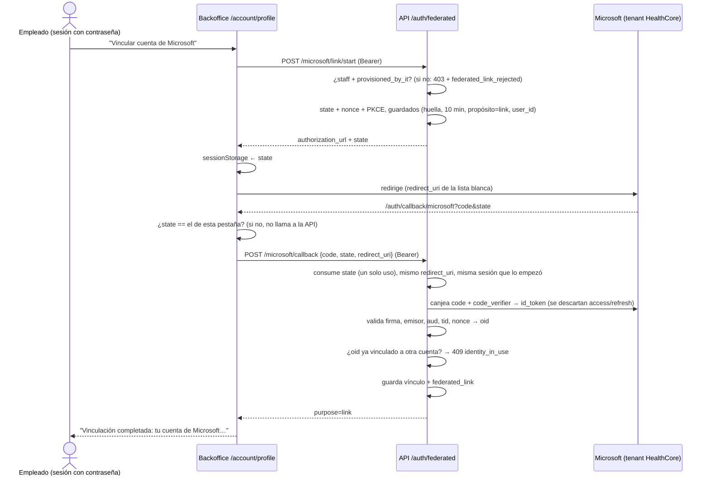
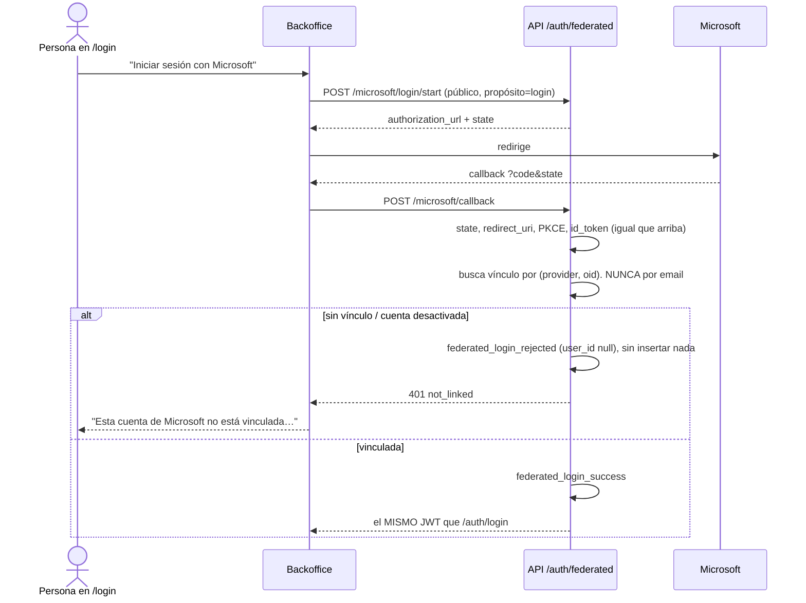

# Autenticación federada con Microsoft

Plataforma – Autenticación Federada (BRIEFING de HealthCore), rama `feature/federated-auth`, 2026-11-07.

Regla del CTO (James Osei): **el login federado nunca crea cuentas**. Solo sirve para entrar a una cuenta que ya existe, que IT ya aprovisionó y que su dueño vinculó él mismo desde su perfil, con la sesión iniciada por contraseña.

## 1. Los dos flujos

Comparten proveedor (Microsoft, único permitido, single-tenant) y el endpoint de callback. **No comparten lógica**: el propósito (`login` o `link`) se guarda en el servidor junto al `state` cuando el flujo empieza, y el callback hace lo que diga ese propósito, nunca lo que diga el navegador.

### Vinculación (solo desde `/account/profile`, con sesión)



### Login federado (desde `/login`, sin sesión)



## 2. Modelo de datos (TinyDB, junto a `users`)

| Tabla | Contenido |
|---|---|
| `federated_identities` | `user_id`, `provider` (`microsoft`), `provider_user_id` (`oid`), `email_at_link_time`, `linked_at`, `provisioned_by_it`. Cero, uno o varios por usuario (uno por proveedor). Único (`provider`, `provider_user_id`), garantizado bajo candado. |
| `oauth_states` | Huella SHA-256 del `state`, propósito, `user_id` (vinculación), `code_verifier`, `nonce`, `redirect_uri`, caducidad. Se borra al consumirse. |
| `federated_audit_events` | `event`, `at`, `user_id` (null en rechazo), `provider`, `provider_user_id`, `reason`. |
| `users` (campos nuevos) | `provisioned_by_it` (lo marca IT/semilla; ausente = no, falla cerrado), `audience` (`staff`), `hashed_password` puede ser `null` (cuenta solo-Microsoft). |

**Ningún token de Microsoft se guarda.** El `id_token` se valida y se descarta. El access token y el refresh token ni se leen. Hay un test que comprueba que en el archivo de la base no queda ningún JWT.

## 3. Seguridad OAuth

- **`state`**: 32 bytes aleatorios. Se guarda solo su huella, es de un solo uso y caduca a los 10 min (`OAUTH_STATE_TTL_SECONDS`). Además el navegador lo guarda en `sessionStorage` y el callback no llama a la API si no coincide. Esto evita el *login CSRF*, el truco de hacer que la víctima entre en la cuenta del atacante.
- **`redirect_uri`**: comparación exacta contra `OAUTH_REDIRECT_URI` (lista separada por comas, sin comodines) al empezar, y en el callback debe ser **el mismo** con el que empezó el flujo. El simulador tampoco redirige nunca a una URI que no esté en la lista.
- **PKCE S256 + `nonce`**: un `code` interceptado no sirve sin el `code_verifier`, que nunca sale del servidor. El `nonce` ata el `id_token` a esta petición.
- **Single-tenant**: emisor `https://login.microsoftonline.com/{tenant}/v2.0` y `tid` igual al de HealthCore. La configuración rechaza `common`, `organizations` y `consumers`.
- **Vinculación atada a la sesión**: el callback de vinculación exige el token de la MISMA cuenta que la empezó (`link_session_mismatch`).
- **Misma sesión que con contraseña**: `create_access_token` es el mismo, así que la caducidad es la misma (`ACCESS_TOKEN_EXPIRE_MINUTES`). La revocación también: una cuenta desactivada deja de valer en la siguiente petición y no puede volver a entrar con Microsoft.

## 4. Desvinculación

Está en el mismo panel del perfil. Con contraseña, se pide confirmación en línea y se desvincula. Si Microsoft es el **único** método de acceso, `GET /auth/federated/links` devuelve `unlink_warning = "last_access_method"`. Entonces la pantalla avisa, desactiva el botón y enlaza a "Crear contraseña" (`/auth/forgot-password`), y la API responde 409 si se intenta igualmente. `federated_rules.unlink_block_reason` es Learn by Doing **delegado**.

## 5. Auditoría

Eventos del BRIEFING §7: `federated_link`, `federated_unlink`, `federated_login_success` y `federated_login_rejected`. Añado `federated_link_rejected` (vincular una identidad ya usada, cuenta sin aprovisionar, sesión cruzada). Cada evento va en dos sitios:

- **Tabla `federated_audit_events`**: consultable en `GET /auth/federated/audit` (solo admin, filtro `?event=`). Guarda `oid` y `user_id` completos, porque el BRIEFING los exige.
- **Línea JSON en el logger `healthcore.audit`**: aquí el actor y la identidad externa van en seudónimo.

Un state inválido o falsificado se audita como `federated_login_rejected` con motivo `invalid_state`.

## 6. Modos y configuración (`services/api/.env`)

| Variable | Uso |
|---|---|
| `MICROSOFT_IDP_MODE` | `mock` (simulador), `microsoft` (Entra real) o vacío (desactivado; con las 3 variables de Microsoft puestas se activa el real). |
| `MICROSOFT_CLIENT_ID` / `_SECRET` / `_TENANT_ID` | App single-tenant registrada en Entra (solo modo real). |
| `OAUTH_REDIRECT_URI` | Lista blanca. Por defecto `http://localhost:3001/auth/callback/microsoft`. |
| `MOCK_MICROSOFT_PUBLIC_URL` | Dónde abre el navegador el simulador (la propia API, `http://localhost:8000`). |

**Desviación del BRIEFING, por decisión del usuario:** el BRIEFING pone el callback en el puerto 3000, pero en este proyecto el 3000 es la web pública y el login del staff está en el backoffice (3001).

Para registrar la app real en Entra: *App registrations → New registration → Accounts in this organizational directory only*; plataforma **Web** (para tener client secret) con la redirect URI exacta; *Certificates & secrets → New client secret*. No hace falta ningún permiso de API más allá de `openid profile email`.

**Simulador** (`routes/mock_microsoft.py`, solo en modo `mock`, fuera de Swagger): pantalla con 5 identidades sintéticas (Marcus, Priya, Alex, `ms-oid-unknown-999` y una de otro tenant). Firma `id_token` RS256 con una clave en memoria, y esos tokens pasan por la misma `validate_id_token` que los de Entra.

## 7. Probarlo

```bash
services/api/.venv/bin/python scripts/seed_federated_auth.py          # imprime la contraseña de la semilla
(cd services/api && MICROSOFT_IDP_MODE=mock SUPPLIERS_DB_PATH=../../data/federated_auth/demo-users.db.json .venv/bin/uvicorn main:app --port 8000)
(cd uis/backoffice && npm run dev -- --port 3001)
(cd services/api && .venv/bin/python -m pytest tests/test_federated_auth.py -o addopts="")   # 49
(cd uis/backoffice && npx jest __tests__/federated.test.ts)                                   # 8
```

Recorrido verificado en Chrome (2026-11-07):

1. "Iniciar sesión con Microsoft" con la cuenta no vinculada → mensaje explícito, sin sesión y `federated_login_rejected` (user_id null).
2. Priya entra con contraseña → perfil → "Vincular" → elige su cuenta → "Vinculación completada" y la ve vinculada.
3. Alex entra con Microsoft → `federated_login_success` → en su perfil, aviso de único método y botón desactivado.

Evidencia del rechazo para el PR: `test_unlinked_microsoft_login_is_rejected_and_creates_no_account` (número de usuarios igual antes y después, 401 `not_linked`, evento con `user_id` null).

## 8. Residuales

- La unicidad del vínculo y el consumo del `state` usan candados de proceso. Con varios workers de uvicorn harían falta una base con índice único y un borrado atómico (mismo residual que `LockedJSONStorage`).
- En modo simulado, el `oid` elegido aparece en el log de acceso de uvicorn (la URL de `/dev/mock-microsoft/select`). En modo real esa petición va a Microsoft, no a la API.
- `login_succeeded` de telemetría no se emite para el login federado. La traza de auditoría es la fuente para estos eventos.
- No se ha probado contra un tenant de Entra real (no había registro de app). El canje real está cubierto con un endpoint de tokens simulado (`httpx.MockTransport`).
