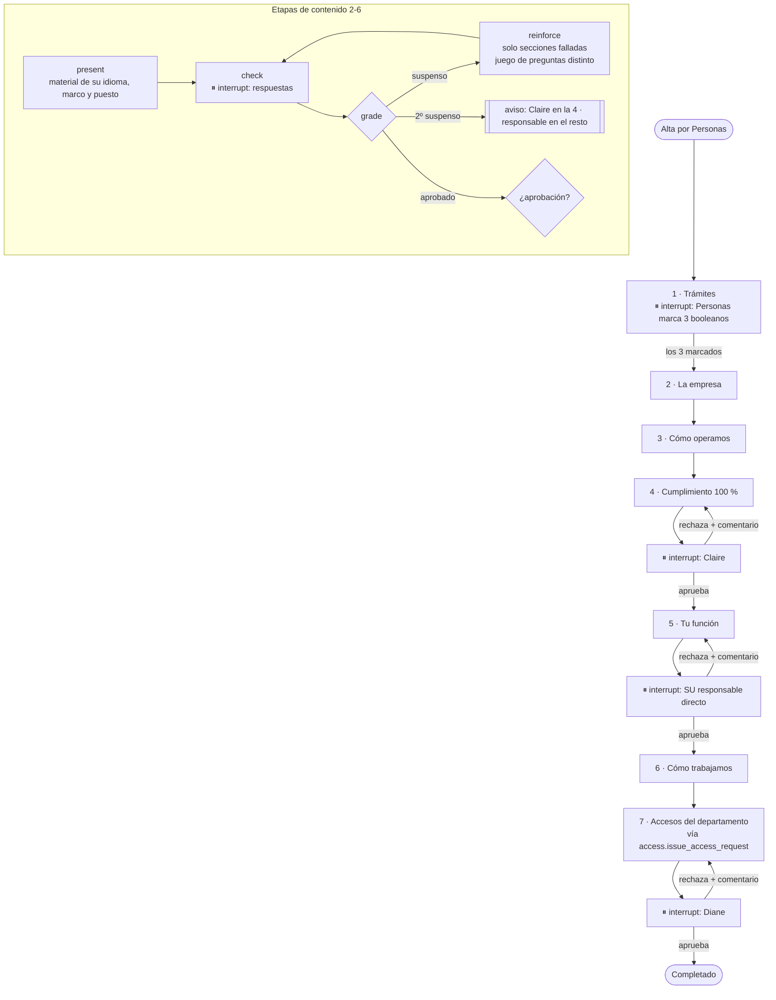

# Orquestador de incorporaciones — HealthCore

Agentic Engineering, "Agente de incorporaciones". Rama `feature/onboarding-orchestrator` (apilada sobre `feat/final-pitch`), 2026-11-07. Stakeholder: Diane Foster, VP of People. BRIEFING: `content/contexts/onboarding-orchestrator/` del currículo (copia de trabajo en Descargas).

> "Ninguna incorporación recibe acceso a un sistema con información de pacientes hasta haber superado la etapa de cumplimiento y que Claire lo haya aprobado. Si el sistema permite saltarse este paso, no nos sirve." — Diane Foster

## 1. Qué hace

Un **único agente LangGraph con estado persistente** lleva a cada persona corporativa (no clínica) por las 7 etapas del BRIEFING, en orden, durante días: presenta el material oficial adaptado a su puesto, corrige las comprobaciones, refuerza lo fallado, responde dudas solo con el material (citando) o las deriva, se detiene en cada aprobación humana hasta que decide quien tiene permiso, avisa antes de cada plazo y escala cuando vence. Todo queda auditado como acción de proceso automatizado.

## 2. Etapas (literal del BRIEFING)

| # | Etapa | Salida verificable | Plazo | Aprueba | Nodos del grafo |
|---|---|---|---|---|---|
| 1 | Bienvenida y trámites | Personas marca contrato, nómina y verificación **completada** (3 booleanos) | Día 2 | Equipo de Personas | `s1_welcome_paperwork__paperwork` |
| 2 | La empresa | Comprobación ≥ 80 % | Día 3 | Automática | `s2_company__{present,check,grade,reinforce}` |
| 3 | Cómo operamos | Comprobación ≥ 80 % | Día 4 | Automática | `s3_operations__…` |
| 4 | Cumplimiento (HIPAA o UK GDPR) | Comprobación **100 %** **y** aprobación | Día 6 | Claire Whitfield | `s4_compliance__…` + `__approval` |
| 5 | Tu función (por puesto) | Comprobación ≥ 80 % **y** aprobación | Día 8 | Responsable directo | `s5_role__…` + `__approval` |
| 6 | Cómo trabajamos | Comprobación ≥ 80 % | Día 9 | Automática | `s6_ways_of_working__…` |
| 7 | Accesos y cierre | Diane aprueba el cierre | Día 10 | Diane Foster | `s7_access_closure__{access,approval}` |

"Día N" = N-ésimo día hábil (lunes a viernes) contando el inicio como día 1; vence al acabar ese día en la zona horaria de la sede (`America/Chicago` / `Europe/London`). Sin festivos: el BRIEFING no da calendario. Fuente única: `services/onboarding/catalog.py::STAGES`; el test `test_stages_match_the_briefing_table_exactly` la fija.

## 3. Grafo

Vista por etapas (el grafo completo, generado del código compilado, está en [`graph.mmd`](graph.mmd)):



No existe ninguna arista de las etapas 1-3 a las 5-7 (`test_there_is_no_edge_that_skips_the_compliance_stage`).

## 4. Por qué un solo agente (y no varios)

El onboarding es **secuencial, largo y con un único hilo de responsabilidad**: en cada momento hay una sola cosa que hacer para esa persona. Lo difícil no es razonar en paralelo sino **no perder el estado** durante días. Un grafo explícito + checkpointer + una herramienta de consulta resuelve exactamente eso:

- **Un solo dueño del estado.** Con varios agentes (contenido, trámites, dudas) habría que sincronizar quién sabe que la etapa 4 está aprobada; aquí es una clave del estado del grafo, y el bloqueo de accesos la lee de un único sitio.
- **El orden es la regla de negocio.** "El orden no es opcional" se garantiza con aristas, no con mensajes entre agentes que podrían llegar desordenados.
- **Depurable y auditable.** Un hilo de checkpoint por persona (`onboarding-<id>`) cuenta toda su historia; cada nodo deja su evento de auditoría.
- **Más barato.** El modelo solo se usa para redactar respuestas a dudas a partir de extractos. Presentar, corregir y decidir no necesitan un LLM: son código determinista (y por eso testeable al 100 %).
- **Lo que NO es el agente:** las dudas no avanzan el grafo, así que se responden fuera de él con la misma identidad y permisos (no es un segundo agente: es una herramienta del mismo, sin estado propio).

## 5. Persistencia y reanudación

- Checkpointer: Postgres de Supabase si `DATABASE_URL` es Postgres (reutiliza `open_checkpointer` de las aprobaciones de RFP, con `prepare_threshold=None` por el pooler); si no, SQLite (`ONBOARDING_CHECKPOINT_DB`, por defecto `data/onboarding/checkpoints.sqlite`, en `.gitignore`).
- Un hilo por incorporación → incorporaciones paralelas aisladas (`test_parallel_onboardings_keep_isolated_state`).
- `runner.advance()` es idempotente: arranca, reanuda con `Command(resume=…)` la entrada humana guardada por la API (`pending_command`), o solo sincroniza. Lock por incorporación (advisory lock en Postgres).
- **Prueba de reinicio** (`tests/onboarding/test_onboarding_resume.py`): un proceso lleva una incorporación a la etapa 3 y **se mata con SIGKILL**; un proceso nuevo abre los mismos archivos y la encuentra en `s3_operations__check`, intento 1, mismo juego de preguntas, etapas [1, 2] completadas; sigue y cierra la etapa 3 sin volver a corregir la 2.

## 6. Material oficial y comprobaciones

- `docs/company-onboarding/{en,es}/*.md`: 7 documentos en inglés (empresa, operación, cumplimiento HIPAA, cumplimiento UK GDPR, función ingeniero/a Digital, función analista de Ciclo de Ingresos, cómo trabajamos) y 6 en español (todo menos UK GDPR). Hechos sacados del CONTEXT de HealthCore. El ejemplo de la etapa 3 es "Patient A", ficticio y sin datos realistas (test).
- **Idioma (decisión del usuario: inglés + español).** El español existe solo para incorporaciones bajo HIPAA (el BRIEFING lo justifica "para Florida"). Español + UK GDPR se rechaza al dar de alta (400): el agente nunca traduce al vuelo una política que no existe.
- **Adaptación al puesto sin modelo:** secciones con `{for: digital}` solo para ese departamento; etapa 4 por marco; etapa 5 por puesto. Un puesto sin material de etapa 5 no se puede dar de alta.
- **Comprobaciones (decisión del usuario: banco fijo).** `docs/company-onboarding/checks/<doc>.<idioma>.json`: 2 juegos de 5 preguntas por documento; intento n → juego (n-1) % 2, así dos intentos seguidos nunca repiten preguntas. Umbral 80 % (100 % en la 4). Suspenso → `reinforce` presenta solo las secciones de las preguntas falladas. Al segundo suspenso de la ronda, aviso a Claire (etapa 4) o al responsable directo (resto); la etapa nunca se salta. Al navegador nunca llega la respuesta correcta.

## 7. Dudas: material oficial o derivación

`services/onboarding/qa.py`. La duda se **redacta antes de todo** (no se guarda ni llega al modelo el texto original). Se busca en `healthcore_onboarding` (Qdrant, colección propia) **filtrando por idioma, variante y departamento** de esa persona: alguien bajo UK GDPR nunca recibe una cita de la política HIPAA (test con Qdrant en memoria).

- Ningún fragmento supera el umbral → **no se llama al modelo**: texto fijo "no está en el material oficial, se lo he pasado a …" + aviso.
- Hay fragmentos → el modelo redacta solo con ellos y contesta `NOT_COVERED` si no bastan (→ se deriva igual). Las citas (`doc_id §Sección`) las pone el código.
- Buscador o modelo caídos → se deriva (nunca se inventa).
- **A quién** (`routing.py`, Learn by Doing delegado): palabras clave de cumplimiento con límite de palabra → Claire; si no, la sección más parecida es de la etapa 4 → Claire; la etapa actual solo decide si el buscador no dio pista; el resto → Diane. Ante la duda, a Claire (coste asimétrico: Diane pidió explícitamente no recibirlas).

## 8. Aprobaciones

`approvals.authorize` (pura) con el directorio `onboarding_staff` (rol **organizativo** + departamento; nunca el rol `admin` de la plataforma): Personas (etapa 1), `compliance_approver` de Cumplimiento (4), el `line_manager` **que es su responsable** y del mismo departamento (5), `vp_people` (7). Nadie aprueba su propia incorporación. Se comprueba en la API (403 + evento de seguridad auditado) **y** otra vez dentro del grafo antes de avanzar. Rechazo → comentario obligatorio (sin datos sensibles), vuelta al inicio de la etapa, aviso a la persona.

## 9. Seguimiento y escalado

`followup.sweep()` (tarea Celery `onboarding.followup_sweep` o `scripts/onboarding_followup.py` cada hora): recordatorio a la persona 24 h antes del plazo; vencida → escalado al responsable directo; **etapa 4 vencida → aviso a Diane, sin escalado y sin vía para saltarla**. Idempotente por clave (etapa, ronda, tipo). Avisos en bandeja interna (`onboarding_notifications`, decisión del usuario: sin correos reales).

Vistas: `/onboarding` (Personas/Cumplimiento ven todas; un responsable, su equipo): activas, etapa, vencimiento, **bloqueadas con el motivo** (esperando trámites/aprobación, vencida, 2+ suspensos, error técnico). `/onboarding/[id]`: etapas, trámites, aprobación, accesos y auditoría. `/onboarding/me`: progreso, lo que falta, material, comprobación, dudas, accesos y bandeja.

## 10. Seguridad y trazabilidad

- **Identidad del agente** `onboarding-orchestrator`, con `AGENT_CAPABILITIES` (presentar, corregir, responder con el material, avisar, emitir accesos de la etapa 7 por la misma puerta que una persona). Ninguna capacidad de aprobar, ver incorporaciones, dar de alta ni marcar trámites; test por cada rol humano.
- **Auditoría**: tabla `onboarding_audit_events` + logger `healthcore.onboarding.audit` (JSON, campos cerrados): `actor_type=agent` + `actor_ref=onboarding-orchestrator` + `automated=true` en las acciones del agente; `actor_type=human` + seudónimo SHA-256 en las de personas.
- **Restricción específica**: `access.issue_access_request` es el único punto de emisión. Sistema con datos de pacientes sin etapa 4 aprobada (`compliance_approved_at`, que solo escribe la sincronización del grafo) → fila `blocked`, evento de seguridad `patient_data_access_blocked`, aviso a Claire y a la persona, 403.
- **Datos sensibles** (identidad/fiscal, banco, salario, cualquier detalle de la verificación): no hay columna donde guardarlos; la API rechaza campos fuera de lista **sin repetir el valor** (400 manual, no 422 de Pydantic, que lo devolvería); el texto libre pasa por `sensitive.py` (dudas redactadas, comentarios rechazados); los avisos pasan `assert_clean`. `test_sensitive_data_never_reaches_logs_db_checkpoints_prompts_or_messages` busca SSN, NI, IBAN, salario y resultado de verificación en logs, prompts enviados, **bytes** de la base y del checkpointer, avisos y dudas guardadas.

## 11. Cómo ejecutarlo

```bash
services/api/.venv/bin/python -m pytest tests/onboarding                                   # 71, sin red
(cd services/api && .venv/bin/python -m pytest tests/test_onboarding_api.py -o addopts="")  # 17
docker compose up -d qdrant && services/api/.venv/bin/python scripts/index_onboarding_docs.py
services/api/.venv/bin/python scripts/evaluate_onboarding_retrieval.py                    # calibración del umbral
services/api/.venv/bin/python scripts/seed_onboarding.py --blocked-attempt                # semilla en Supabase
services/api/.venv/bin/python scripts/onboarding_followup.py                              # barrido de plazos
```

Con la semilla: `SUPPLIERS_DB_PATH=data/onboarding/demo-users.db.json` al arrancar la API, worker de Celery (`--pool=solo` en macOS) y Redis, y entrar en el backoffice con las cuentas que imprime el script.

## 12. Evidencia real (2026-11-07)

**Reanudación tras reinicio sobre Postgres (Supabase), dos procesos:** el proceso A (pid 10978) marca los trámites de Jordan Lee como Ruth (Personas) y supera la etapa 2; el proceso B (pid 10983, nuevo) lee el checkpoint de Supabase y encuentra `graph.next = ['s3_operations__check']`, `waiting_for = {check, etapa 3, intento 1, operations:en:0}`, etapas `[1, 2]`. La variante con SIGKILL a mitad está en `tests/onboarding/test_onboarding_resume.py` (SQLite, sin red).

**Semilla** (`scripts/seed_onboarding.py --blocked-attempt`): 3 incorporaciones (Austin/EN, Londres/UK GDPR, Austin/ES) en `awaiting_paperwork`; el intento de Sofía Herrera de pedir Epic sin etapa 4 → `blocked`, evento `patient_data_access_blocked` y aviso a Claire. Repetirla no duplica nada.

**Calibración del umbral** (`data/eval/onboarding_retrieval_evaluation.json`, 88 secciones indexadas con embeddings reales): 14/14 preguntas cubiertas por encima de 0.38 (peor: 0.397), Recall@1 93 % y Recall@4 100 %; 5/6 fuera de material por debajo (mejor fuera de tema: 0.363, "¿hay parking?"). La sexta, "¿cuánto se conservan los registros de accesos?" (0.448), es un detalle no escrito de un tema que sí está: la para el modelo.

**Dudas con el modelo real** (deepseek-v4-flash por el proxy de 4Geeks):

| Duda | Resultado | Tiempo |
|---|---|---|
| How many days do we have to notify patients after a breach? | **answered**: "60 days after the breach is discovered [1]." · cita `compliance-hipaa §Incident notification` | 24 s |
| How long are access logs retained before deletion? | **routed → Claire**, `model_found_material_insufficient` (el modelo respondió NOT_COVERED) | 22 s |
| Can I expense a standing desk for my home office? | **routed → Diane**, `not_in_official_material`, sin llamar al modelo | 0,9 s |
| Where do I upload my passport? My SSN is 123-45-6789. | SSN redactado antes de todo (`[ID number removed]`); routed → Claire (la sección más cercana es de cumplimiento: lado seguro de la regla) | 0,8 s |

Respuesta derivada que recibe la persona: *"This is not covered by HealthCore's official onboarding material, so I will not guess. I have passed your question to Diane Foster (People), who will get back to you."*

**Pendiente de verificar a mano:** recorrido en el navegador con API + Redis + worker de Celery (la API y el grafo están cubiertos por los tests con el worker sustituido por una ejecución en línea).
