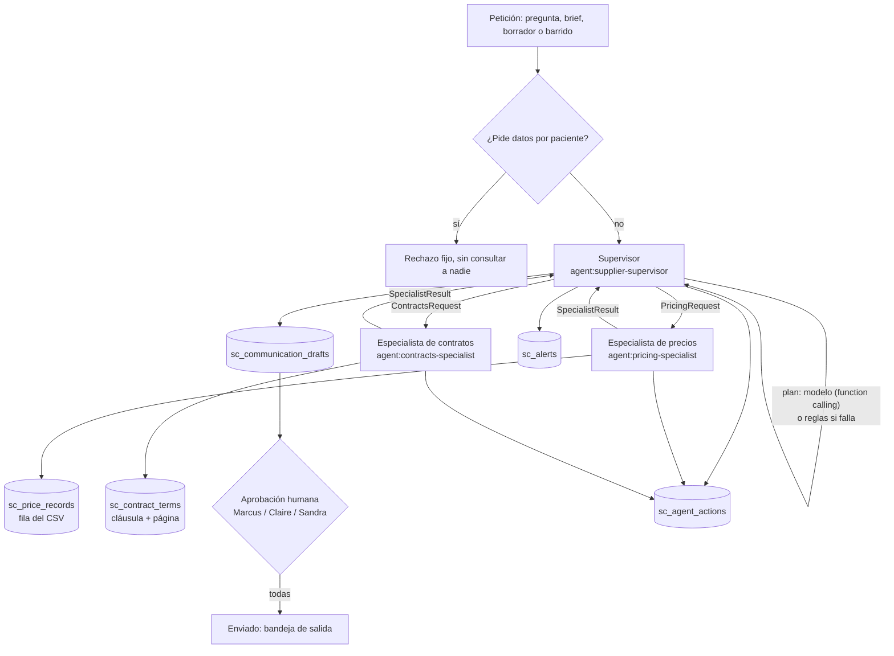

# Gestión de proveedores y contratos (Agentic Engineering)

Rama `feature/supplier-contracts`, 2026-11-07. Stakeholder: Dr. Marcus Reid (Operaciones Clínicas). BRIEFING de
HealthCore en `content/contexts/supplier-contracts/` del repo del currículo.

## 1. Arquitectura



| Agente | Herramientas (lista cerrada en `catalog.AGENT_TOOLS`) | No puede |
|---|---|---|
| Supervisor | `consult_pricing_specialist`, `consult_contracts_specialist`, `build_renegotiation_brief`, `draft_supplier_communication`, `raise_alert`, `compute_exit_cost` | Leer precios o contratos directamente |
| Precios | `get_price_history`, `detect_price_increases`, `compute_increase_impact`, `compare_same_category_prices`, `convert_currency` | Ver contratos |
| Contratos | `get_contract_terms`, `evaluate_price_review_clause`, `compute_contract_deadlines`, `check_data_protection_agreement`, `lookup_clause` | Ver precios |

`AgentRuntime.call` aplica la lista: una herramienta ajena lanza `ToolNotAllowed` y queda registrada como `denied`.

## 2. Contratos de entrada y salida (`services/supplier_contracts/runtime.py`)

**Especialista de precios** — entrada `PricingRequest`:

| Campo | Valores |
|---|---|
| `intent` | `price_history` · `detect_increases` · `increase_impact` · `compare_alternatives` |
| `supplier_id` | `HC-S01`…`HC-S07`; `null` solo en `detect_increases` (todos) |

**Especialista de contratos** — entrada `ContractsRequest`:

| Campo | Valores |
|---|---|
| `intent` | `contract_terms` · `increase_permission` · `notice_deadline` · `clause_lookup` · `data_protection_status` |
| `supplier_id` | `null` solo en `data_protection_status` (todos) |
| `increase_pct` | subida a evaluar (la calcula el de precios y la pasa el supervisor) |
| `topic` | término para `clause_lookup` |

**Salida de ambos** — `SpecialistResult`: `agent_id`, `intent`, `status` (`ok` · `no_contract` · `no_data` ·
`not_found`), `facts` (cada cifra con sus `refs`), `findings` (frases ya redactadas), `missing` (lo que no existe,
declarado) y `alerts`. Un `Ref` es `price_record` (fila del CSV), `contract_clause` (§ y página), `reference`
(dato del BRIEFING) o `calculation` (fórmula).

## 3. Por qué multiagente

Precios y contratos son especialidades distintas (fuentes, herramientas y criterios distintos: CSV agregado frente a
PDF con cláusulas), pero las preguntas importantes las cruzan: "¿esta subida está permitida?" necesita el % del
primero y la cláusula del segundo; el brief necesita los dos más el coste de salida, que solo se calcula juntando
penalización (contrato) y facturación media (precios). Un solo agente con las diez herramientas mezclaría contextos
irrelevantes en cada paso y permitiría, por ejemplo, que la lectura de contratos tocara precios. Con supervisor +
especialistas cada uno tiene alcance, contexto e identidad propios, y el coste (contratos de E/S y control de
bucles) se resuelve con `PricingRequest`/`ContractsRequest`/`SpecialistResult` y un tope de 8 consultas por
petición. El modelo se llama una sola vez por petición (elige especialistas e intenciones); no hay bucle de
replanificación.

## 4. Decisiones

- **El modelo decide, el código calcula** (decisión del usuario: modelo + respaldo por reglas). Las cifras son
  `Decimal` en `calculations.py`. El modelo también redacta borradores, pero un número que no esté en los hechos o
  un dato sensible descarta el borrador y se usa la plantilla.
- **Extracción determinista** (decisión del usuario): `pdfplumber` + reglas por término. Confianza 0,95 exacta;
  parcial o contradictoria < 0,8 → `doubtful`; sin cláusula → `missing`. Nunca se rellena lo que el contrato no dice.
- **Supabase** (tablas `sc_*`), SQLite en tests. Recargar sustituye proveedores/precios/contratos; alertas,
  borradores, aprobaciones y acciones nunca se borran.
- **BAA/DPA primero.** Si el proveedor procesa datos de pacientes, su acuerdo se consulta antes que nada. Brief y
  borradores se detienen (409) sin acuerdo firmado hasta que Cumplimiento autoriza (`/compliance-clearances`).
- **Subida evaluada:** la del último mes frente al tope anual de la cláusula. El histórico no registra la fecha de
  la última revisión anual, y la respuesta lo declara.
- **Lone Star Diagnostics** procesa datos de pacientes y no tiene contrato ni BAA: también alerta a Claire. Es la
  alternativa más barata a ClearPath, y el brief la condiciona a firmar el BAA.
- **Vencimiento:** solo el umbral más cercano ya alcanzado (a 28 días, el de 30; no los dos).
- **Enviar = registro** en la bandeja de salida: no hay canal real. Solo Operaciones Clínicas lo marca, y solo con
  todas las aprobaciones.

## 5. Datos sensibles (BRIEFING)

| Dato | Dónde podría aparecer | Defensa |
|---|---|---|
| Datos bancarios del proveedor | cláusula 8 de cada PDF | la cláusula de facturación nunca se lee ni se cita; `sensitive.redact` en citas, prompts, borradores y comentarios |
| Contactos del proveedor | cláusula 8.3 | ídem; los borradores saludan "Dear X team" |
| Datos de pacientes | preguntas | `is_patient_level_request` rechaza antes de planificar; el CSV solo tiene agregados |

La pregunta y los prompts no se guardan: solo su SHA-256. Las personas aparecen como `human:<seudónimo>`.
`tests/supplier_contracts/test_sensitive_data.py` recorre todo el sistema con un modelo que intenta colar un IBAN y
busca los valores ficticios de `catalog.SENSITIVE_BILLING` en tablas, logs, prompts y respuestas.

## 6. Ejemplos (fecha de carga 2026-11-07)

**Escenarios del BRIEFING** (`test_alerts.py::test_sweep_raises_exactly_the_briefing_alerts`):

| Esc. | Proveedor | Último mes | Resultado |
|---|---|---|---|
| A | ClearPath Labs | +7,00 % | Alerta a Marcus; **no permitida** (tope IPC 2,90 %, exceso 4,10 %, CT-HC-02 §4.2 p. 2); preaviso el 2026-11-22 |
| B | MedSupply Partners | +4,50 % | Alerta a Marcus; **permitida** (tope 5 %, CT-HC-01 §4.2 p. 2) |
| C | Thames Pathology | +2,00 % | Sin alerta de precio; **falta el DPA** → alerta a Claire; brief detenido |
| D | LinguaCare | 0,00 % | Sin alerta de precio; vence en 28 días (alerta de 30) y preaviso el 2026-11-20 |

Alerta real del escenario A: `evidence/example-alert-clearpath.json`. Brief real con trazabilidad:
`evidence/example-brief-clearpath.md` (12 meses con su fila del CSV, cláusulas con página y referencias numeradas).

## 7. Cómo ejecutarlo

```bash
services/api/.venv/bin/python scripts/seed_supplier_contracts.py      # genera, ingiere, crea cuentas y alertas
cd services/api && SUPPLIERS_DB_PATH=../../data/supplier_contracts/demo-users.db.json .venv/bin/uvicorn main:app --port 8000
cd uis/backoffice && npm run dev -- --port 3001                        # /supplier-contracts
services/api/.venv/bin/python -m pytest tests/supplier_contracts      # 121, sin red
(cd services/api && .venv/bin/python -m pytest tests/test_supplier_contracts_api.py -o addopts="")   # 10
```

`SUPPLIER_CONTRACTS_USE_MODEL=0` desactiva el modelo (plan por reglas y borradores de plantilla).
